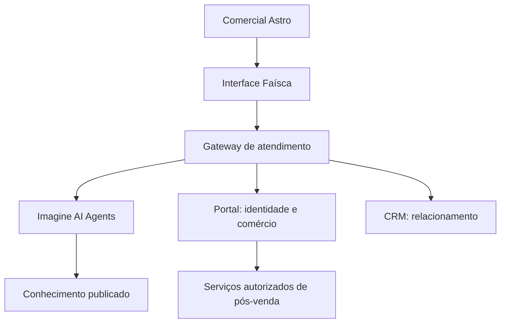

# Faísca — execução do Comercial e evolução para os produtos Imagine

**Referência:** R01, 17/11/2026, horário de São Paulo.

**Coordenação de produto:** Rafhael / Direção Imagine.

**Continuidade:** atividade [Comercial #444](https://github.com/rafhael100/imagine-comercial/issues/444), plano mestre v1 e aprovação posterior da identidade 3D.

**Base examinada:** Comercial [#448](https://github.com/rafhael100/imagine-comercial/pull/448), `209bd893e741e7fd8d824d8e184471a86ee267ab`.

## 1. Resultado que estamos construindo

Faísca é a interface de relacionamento da Imagine. No Comercial, deve ajudar a pessoa a escolher uma solução adequada, esclarecer dúvidas e encontrar o próximo passo de compra. Depois da contratação, deve explicar como acompanhar o serviço e, quando integrado e autenticado, consultar os dados autorizados do cliente e encaminhar demandas com contexto.

O objetivo comercial é uma conversa útil: compreender, recomendar com motivo, esclarecer uma objeção e oferecer um próximo passo. Não usar insistência, falsas garantias, urgência artificial ou promessas de execução não confirmada. Ser o melhor vendedor exige precisão e continuidade no atendimento, além de simpatia.

**Primeira entrega de código:** demonstração guiada autocontida, com o render aprovado, três entradas de conversa, perguntas por objetivo, conteúdo editorial local, resumo de escolhas, reinício e controles acessíveis. Ainda não é o vendedor com LLM nem uma integração operacional.

## 2. Decisões já estabelecidas

1. Preservar integralmente o Faísca 3D aprovado. A referência gráfica é o PNG com SHA-256 `1ede4d88a38e238523c6db7351f22654ffa40b9f8ee2260ea31b162763d8c87d`. O plano v1 descrevia um personagem Windows anterior; a aprovação posterior do render define a aparência desta entrega.
2. Iniciar pelo Comercial. Arquitetura preparada para outros produtos, sem implantar simultaneamente em todos.
3. Portal mantém catálogo oficial, identidade, cotação, contratação e pagamento. CRM mantém relacionamento, leads, oportunidades e sua automação. Agents mantém modelo, políticas e ferramentas.
4. Desenvolvimento em branches isoladas e PRs draft. O pedido atual autoriza avançar na implementação e preparar trabalho para o Codex; publicação, custos, dados reais e mudanças operacionais permanecem sujeitos às autorizações específicas existentes.
5. Astro mantém sua arquitetura estática. O laboratório está fora das rotas públicas, conforme F31 e a própria atividade #444. Não afrouxar verificadores para encaixar o chat.
6. Texto primeiro. Voz e modelo realmente articulado evoluem em paralelo quando houver materiais e ambiente adequados, sem atrasar os fluxos úteis de atendimento.

## 3. Papel comercial e postura do personagem

**Apresentação:** “Sou o Faísca, assistente virtual da Imagine.” Nunca se passar por vendedor humano. Em demonstração, informar que as respostas são guiadas e locais.

**Método de conversa proposto:**

| Etapa | Comportamento | Resultado verificável |
|---|---|---|
| Compreender | Uma pergunta curta sobre o objetivo | Pessoa escolhe a necessidade |
| Qualificar | Só perguntas que mudam a recomendação | Contexto mínimo e útil |
| Recomendar | Explicar por que aquela solução ajuda | Produto e motivo claros |
| Resolver dúvida | Base editorial e fonte atual | Resposta sem condição inventada |
| Próximo passo | Comparar, preparar resumo ou ir ao ambiente autorizado | Ação voluntária |
| Continuar | Retomar contexto quando permitido | Cliente evita repetir informações |

Campos futuros de qualificação: objetivo, tipo de negócio, solução atual, prioridade e prazo desejado pelo cliente. Orçamento é opcional e jamais se converte sozinho em preço prometido. Não pedir contato pessoal antes de entregar valor; quando necessário, explicar a finalidade e mostrar o resumo que será encaminhado.

As respostas iniciais devem ser curtas, com explicação expandida quando solicitada. Se a base não cobrir a pergunta, reconhecer a lacuna e oferecer encaminhamento. Para CRM, Performance e demais produtos sem catálogo público homologado, tratar detalhes como sujeitos à proposta oficial.

## 4. Jornadas e evolução do pós-venda

### Comprar ou escolher solução

- Presença institucional objetiva → comparar Onepage e site com várias páginas.
- Campanha/oferta específica → avaliar Landing Page.
- Organizar contatos e acompanhamento comercial → explicar o papel do CRM, sem inventar plano ou limite.
- Divulgar e captar oportunidades → explicar gestão de anúncios e a separação entre mídia e gestão.
- Final da conversa → resumo por escolhas e próxima ação. Preço final só vem do Portal vigente.

### Tirar dúvidas

Comparações, materiais de início, etapas do projeto, proposta, aprovações e resultados esperados. Dúvida sobre preço, desconto, prazo ou condição não confirmada não pode ser respondida a partir de lembranças da conversa, exemplos de teste ou saída livre do modelo.

### Pós-venda

| Nível | Disponibilidade prevista | Limite |
|---|---|---|
| Orientação pública | Demonstração R01 | Explica acompanhamento e canais; não lê conta |
| Triagem de suporte | Gateway + encaminhamento homologados | Confirma envio só após recibo real |
| Consulta de serviço | Portal autenticado | Empresa, usuário e serviço derivados do backend |
| Acompanhamento proativo | Fase futura | Opt-in, regras aprovadas e fontes de estado confiáveis |

Exemplos futuros: estado do briefing, necessidade de material, prévia aguardando aprovação, prazo contratual publicado, registro de solicitação e confirmação de recebimento pela equipe. O Faísca não diz que um site foi entregue, um pagamento foi quitado ou um chamado foi aberto apenas porque o usuário afirmou isso.

## 5. Arquitetura sem duplicação

O desenho é a arquitetura pretendida, não evidência de conexões existentes. O incremento atual implementa somente a interface, conhecimento local e domínio guiado. Não acrescenta infraestrutura nem instala outro motor de automação.

**Reutilização futura:** configuração de produto, idioma, temas de ajuda e ferramentas permitidas. A UI é compartilhável. Permissões, empresa e identidade são derivadas no servidor e nunca confiadas a `product_id`, `tenant_id` ou texto enviados pelo browser. A transição ao Portal não compartilha automaticamente a sessão do CRM.

## 6. Contratos candidatos para a integração

Estes são formatos a revisar com os donos dos serviços; não são endpoints existentes.

| Operação | Entrada mínima | Resposta verificável |
|---|---|---|
| Mensagem | texto limitado, idioma, ID idempotente, contexto público permitido | texto, fontes, ações permitidas, modo, correlação |
| Catálogo | versão e idioma públicos | itens publicados, versão, validade |
| Cotação | SKUs e configuração escolhida | ID, valores em centavos, moeda, validade e origem Portal |
| Lead | contato revisado, resumo revisado, evidência de consentimento | ID/recibo real, estado e chave idempotente |
| Atendimento humano | motivo, contexto mínimo e confirmação | recibo de encaminhamento ou falha explícita |
| Pós-venda | serviço e operação solicitada | somente dados autorizados pela sessão verificada |

**Regras de aceitação:** ações retornadas pelo modelo passam por allowlist e validação no backend; URLs do modelo não são seguidas automaticamente. Expiração, revogação, escopo, limites de uso e autorização são conferidos a cada ferramenta. Solicitações com tenant/role arbitrários não ampliam direitos. Preços vencidos deixam de ser ofertáveis. Timeout ou resposta ambígua não é sucesso.

A UI futura receberá `mode=public_assistant` ou `authenticated_support` apenas de configuração operacional confiável. Alterar o rótulo do protótipo não deve habilitar integração. Chaves de IA permanecem no servidor. A autorização real nunca será implementada por palavras-chave ou somente por prompt.

## 7. Conhecimento e qualidade de vendas

Base inicial: `src/data/services.mjs`, `src/data/commercial-faq.mjs` e `src/data/commercial-process.mjs` da referência fixada. O snapshot do Faísca mantém proveniência; revisão operacional/editorial ainda será concluída antes do piloto.

Cada item futuro precisa de dono, versão, idioma, período de validade e marca de publicável. Dados internos de clientes não entram no índice público. Alterações de catálogo invalidam respostas antigas relativas a condições. Não usar conversas de clientes como treinamento automático.

**Conjunto de avaliação mínimo:** perguntas frequentes reais anonimizadas e aprovadas, diferentes formas de pedir o mesmo serviço, objetivos ambíguos, limitações do produto, descontos inventados, garantias de venda, instruções maliciosas, solicitação de atendimento humano e contexto pós-venda. Comparar resposta, fonte, ação e recusa esperada. Não medir qualidade apenas pelo tom simpático.

## 8. Backlog organizado por resultados

| Marco | Itens do plano mestre | Entrega | Dependência |
|---|---|---|---|
| R01, em revisão | P0-01/02/03/04/05/06/08, recortes | Render intacto, UI, domínio guiado, fontes e testes | Recuperação do material e revisão |
| R02 | P0-03/04/13 | Componente Astro reutilizável em página privada de laboratório | R01 revisado, preserve F31 |
| R03 | P0-07/12 | Gateway do Agents com provedor simulado, sessão, limites e falhas | Contrato e escolha da base Agents |
| R04 | P0-06/07/08/13 | Modelo de texto real com conhecimento revisado e avaliação | Provedor/orçamento e homologação |
| R05 | P0-09/10/11 | Cotação Portal, lead consentido e encaminhamento | APIs e identidades homologadas |
| R06 | P2-02, extensão de pós-venda | Consulta autenticada de serviço e solicitação de suporte | Sessão, escopo e revogação Portal |
| R07 | P1-01/02 | Piloto limitado e medição de resultado comercial | Revisão, operação, fallback e rollback |
| R08 | P2-01/03 e mídia | Voz, idiomas revisados e rig 3D | R07 e ativos próprios aprovados |

“Em revisão” não significa que todos esses itens estão concluídos. A imagem não é a spritesheet original; o controlador visual demonstra estados com movimento do quadro. A conexão a IA e aos sistemas de negócio continua separada da experiência local.

## 9. Trabalho que podemos fazer aqui e trabalho para o Codex

**Nesta frente:** UX, roteiros, conhecimento versionado, núcleo puro, identidade visual, HTML demonstrável, especificação de contratos, avaliação e revisão do que o Codex devolver. Avançar em tarefas independentes sem reaprovar cada detalhe reversível.

**Próxima execução Codex:** integrar os módulos no laboratório Astro com uma única instância, flag desligada no site público, importação sob demanda e prova de que o dist público permanece inalterado. Depois selecionar a branch atual de Agents e construir o gateway de laboratório. O pedido exato está em `CODEX-PROXIMA-ENTREGA.md`.

Juliana poderá acompanhar a mesma atividade #444 quando retomar, sem um segundo backlog concorrente. Não há comunicação enviada a ela por esta entrega.

## 10. Aceite e métricas

Primeiro marco: abrir a prévia no Windows e navegar pelos três percursos; explicar recomendação; responder perguntas previstas; preparar resumo sem dados pessoais; exibir indisponibilidade sem inventar sucesso; fechar/reabrir/resetar; teclado, mobile e movimento reduzido; zero requests de atendimento e zero storage.

Integração: sessão e escopo reais, cotação vigente, consentimento revisável, gravação idempotente, reenvio sem duplicação, fonte do pós-venda autorizada, registro de revogação, erro que não vira confirmação, comportamento com serviços indisponíveis.

**Indicadores futuros:** necessidade compreendida, dúvida resolvida, encaminhamento correto, lead efetivamente recebido, retorno ao orçamento, conversão confirmada, satisfação, repetição de informações, custo por conversa útil e erros comerciais. Criar denominadores e janelas de atribuição antes de apresentar taxas; não inventar percentuais de desenvolvimento ou aumento de conversão.

## 11. Operação e decisões para o momento adequado

Antes da IA pública: escolher provedor/modelo, política de dados, teto de gasto e responsável editorial. Antes do envio de contatos: contrato CRM e canal humano operacionais. Antes de consultar pedidos: sessão, grants e revogação. Antes de publicar: autorização de ambiente, recursos, monitoramento, teste de rollback e fallback.

Essas dependências não impedem o desenvolvimento local da interface e dos contratos. Não há nova despesa ou contratação por este plano.

## 12. Fontes consultadas

- [Backlog Faísca #444](https://github.com/rafhael100/imagine-comercial/issues/444).
- [Base Comercial #448](https://github.com/rafhael100/imagine-comercial/pull/448).
- [AGENTS da base examinada](https://github.com/rafhael100/imagine-comercial/blob/209bd893e741e7fd8d824d8e184471a86ee267ab/AGENTS.md).
- [Catálogo editorial](https://github.com/rafhael100/imagine-comercial/blob/209bd893e741e7fd8d824d8e184471a86ee267ab/src/data/services.mjs).
- [FAQ editorial](https://github.com/rafhael100/imagine-comercial/blob/209bd893e741e7fd8d824d8e184471a86ee267ab/src/data/commercial-faq.mjs).
- [Astro, arquitetura de ilhas](https://docs.astro.build/en/concepts/islands/).
- [MDN, redução de movimento](https://developer.mozilla.org/en-US/docs/Web/CSS/Reference/At-rules/%40media/prefers-reduced-motion).

O estado operacional dos outros produtos deve ser revalidado na integração. Documentos e testes de laboratório não substituem evidência de implantação.
